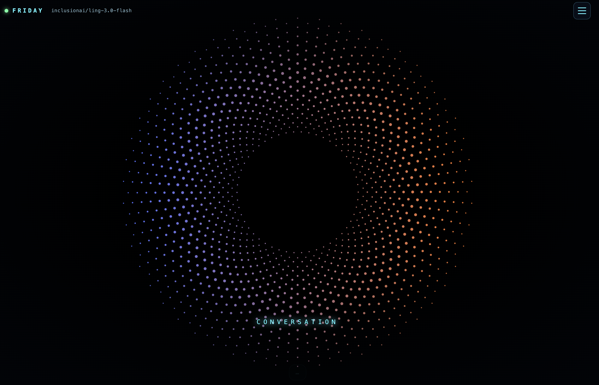

<div align="center">



# 🎙️ HeyFriday

### Your personalised voice AI. Say "Friday", and it gets things done.

**A hands-free, Jarvis-style voice agent that talks back in a natural voice, writes code, runs commands, browses the web and spawns subagents. Any model on OpenRouter. Speech recognition runs on your machine.**

[](LICENSE)


[Quick start](#-quick-start) · [What it can do](#-what-it-can-do) · [How it works](#-how-it-works) · [FAQ](#-faq) · [Credits](CREDITS.md)

**If this saves you from typing even once, [⭐ star the repo](https://github.com/Sumedh1599/heyfriday). It helps other people find it.**

</div>

---

## ✨ Why HeyFriday

Most "voice assistants" answer trivia. HeyFriday is a **real agent** with a voice:

- 🗣️ **Talk like a person.** Wake word, then just speak. A pause sends it, like Siri. Interrupt it mid-sentence and it stops and listens.
- 🧠 **Do real work.** It reads and edits files, runs shell commands, tracks tasks and delegates to **parallel subagents** while you keep talking.
- 🌐 **Use the web.** It drives a **visible Chrome window**: open, click, fill forms, read pages, take screenshots.
- 🔊 **Sound human.** A natural female voice ([Kokoro-82M](https://huggingface.co/hexgrad/Kokoro-82M)) streams sentence by sentence, so speech starts almost immediately.
- 🔒 **Keep your voice local.** Speech recognition ([whisper.cpp](https://github.com/ggml-org/whisper.cpp)) never leaves your Mac. Only the text you send goes to the model you chose.
- 🔀 **Pick any brain.** Star your favourite OpenRouter models and switch between them live, mid-conversation.
- 🎨 **Looks the part.** A fullscreen [Rive](https://rive.app) animation that idles, listens and replies with you, floating subtitles, and cards for subagents, code and flowcharts.

## 🚀 Quick start

You need **macOS**, [Homebrew](https://brew.sh), **Node.js 22+** and an [OpenRouter API key](https://openrouter.ai/keys).

```sh
git clone https://github.com/Sumedh1599/heyfriday.git
cd heyfriday
./install.sh
./Launch.command
```

**Downloaded the ZIP instead of cloning?** macOS flags it and shows *"Apple could not verify 'Launch app' is free of malware"*. HeyFriday is open source and unsigned (no paid Apple developer account), so this is expected. Pick one:

- **Easiest:** use `git clone` as above. Cloned files are never blocked.
- **Terminal:** `cd` into the folder and run `xattr -dr com.apple.quarantine . && ./install.sh`
- **Clicks only:** click *Done*, open **System Settings → Privacy & Security**, scroll down and press **Open Anyway** next to the blocked file, then confirm. (Right-click → Open also works on `Launch.command`.)

You can read every script first: [`install.sh`](install.sh), [`Launch app`](Launch%20app), [`Launch.command`](Launch.command). They only start the local server and open `127.0.0.1`.

`install.sh` runs once (about 1.5 GB: agent, speech models, browser). `Launch.command` (double-click it) opens **http://127.0.0.1:3080**.

Then in the app:

1. Click **Start voice chat** and allow the microphone.
2. Open the ☰ menu (top right), paste your OpenRouter key, press **Save**.
3. Pick a model.
4. Say **"Friday, what's two plus two?"** and pause.

## 🧰 What it can do

Try saying:

| Say this | What happens |
|---|---|
| "Friday, make a Python script that renames my screenshots by date." | Writes it, runs it, tells you the result |
| "Friday, open Hacker News and tell me the top story." | Opens a real browser and reads it back |
| "Friday, draw a flowchart of how login works." | Shows a diagram card; speaks only a short summary |
| "Friday, research three libraries for this in parallel." | Spawns subagents and shows them as live cards |
| "Friday, what calls `parse_config` in my project?" | Queries a local knowledge graph of your code |

**Controls:** conversation mode (no wake word), chat panel and text input, speech speed, auto-send pause (0.8–60 s), custom wake and trigger words, interrupt toggle, clear data, shutdown. Code and diagrams are shown, never read aloud.

## 🧩 How it works

```text
 you ──mic──▶ browser UI ──▶ whisper.cpp (local speech to text)
                  │
                  ▼
        local server (Node) ──▶ DeepSeek Harness agent ──▶ OpenRouter ──▶ any LLM
                  │                  │  tools · subagents · sessions
                  │                  ├─ agent-browser ──▶ visible Chrome
                  │                  └─ graphify ──▶ local code knowledge graph
                  ▼
        Kokoro TTS (local) ──▶ speakers   (streamed sentence by sentence)
```

The server also acts as a small OpenRouter proxy that caps parallel requests and retries rate limits, so a swarm of subagents does not get your key blocked.

## 🛡️ Safety (read this)

> **HeyFriday runs the agent in full-auto mode with unrestricted file and shell access and no approval prompts.** [DeepSeek Harness](https://github.com/deepseek-ai/deepseek-harness) is developer-preview software with no security audit. Use a dedicated machine or account and keep backups.

The server listens on `127.0.0.1` only and rejects foreign hosts and requests without its app header. Never expose port 3080. Your API key lives in `memory/settings.json` (owner-only, git-ignored).

## 🔧 Troubleshooting

| Problem | Fix |
|---|---|
| Nothing happens when I talk | Allow the microphone for `127.0.0.1:3080`; check the wake word in the menu |
| Slow replies or failing tools | Use a stronger model; small ones (e.g. `gpt-oss-20b`) call tools badly |
| 401 or "no credits" | Check your key and balance at [openrouter.ai](https://openrouter.ai) |
| Port 3080 in use | `APP_PORT=3090 ./Launch.command` |

Variables: `APP_PORT`, `APP_NO_OPEN=1`, `APP_DEBUG=1`. Errors also appear on screen with a plain-language fix.

## ❓ FAQ

**Is it free?** The code is. You pay OpenRouter for model usage (some models are free or very cheap). Everything else runs locally.

**Does my voice get uploaded?** No. Transcription and speech synthesis run on your machine. The text of your request goes to the model you pick.

**Windows or Linux?** Untested. The pieces are cross-platform, but the installer and launcher target macOS. Contributions welcome.

**Can I change the voice?** Yes, Kokoro ships many voices (`af_bella`, `af_sarah`, `bf_emma`, ...). Change `VOICE` in `voice/tts_worker.py`.

**Can I use a local model?** Any OpenAI-compatible endpoint is a natural next step; see Roadmap.

## 🗺️ Roadmap

- [ ] Linux and Windows support
- [ ] Voice picker in the menu
- [ ] Local model endpoints (Ollama, LM Studio)
- [ ] Optional approval mode instead of full-auto
- [ ] Packaged app (no terminal)

## 🤝 Contributing

Issues and pull requests are welcome. See [CONTRIBUTING.md](CONTRIBUTING.md).

## 🙏 Credits

Standing on the shoulders of **OpenRouter, DeepSeek Harness, whisper.cpp, Kokoro, kokoro-onnx, agent-browser, graphify, Rive and Mermaid**. Authors and licenses are listed in **[CREDITS.md](CREDITS.md)**. HeyFriday is not affiliated with any of them.

## 📄 License

[MIT](LICENSE). Third-party components keep their own licenses; see [CREDITS.md](CREDITS.md).

<div align="center">

**Built something cool with it? Open an issue and show it off. ⭐ Star if you like it.**

</div>
